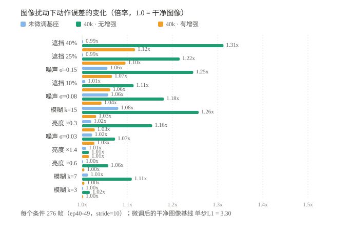
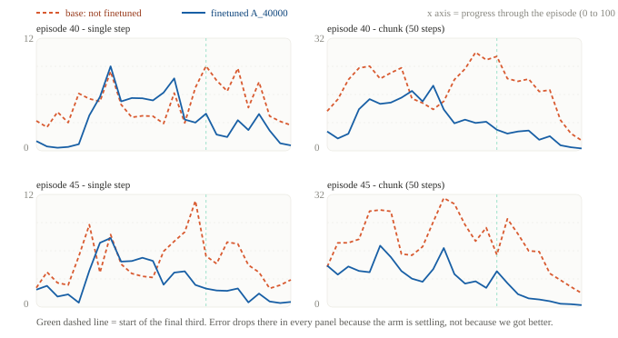
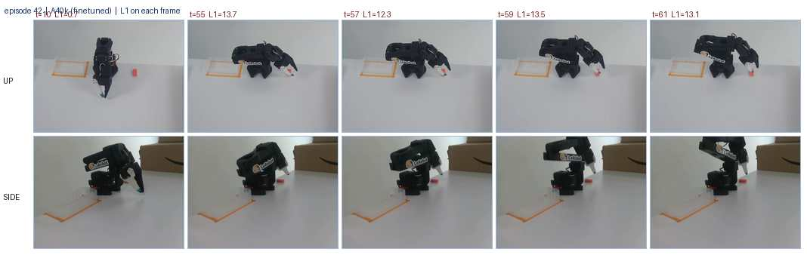

# SmolVLA 微调与离线评测（SO-101 抓放任务）

用 LeRobot 在公开真机数据集 [`lerobot/svla_so101_pickplace`](https://huggingface.co/datasets/lerobot/svla_so101_pickplace)  
上微调 SmolVLA（450 M 参数），并建立一套**离线评测**：留出集动作误差、13 种图像扰动下的  
鲁棒性、逐帧失败归因、以及由实测推理延迟推导的动作块长度消融。

任务：*把粉色乐高积木放进透明盒子*（SO-101 机械臂，up / side 两路相机）。

> **范围**：本项目为「微调 + 离线评测」，**不含真机部署**，因此不提供任务成功率。  
> 文中所有数字均由本仓库脚本产出，原始输出见 [`results/`](results)。


---

## 结果

评测口径：每个任务最后 20% 的 episode 留出（10 条 / 2759 帧，训练时从未接触）。  
指标为预测动作与真值动作在 6 个关节维上的平均 L1 距离，越小越好。

| 模型               |       训练数据 | 训练步数 |     单步 L1 | 相对基座（95% CI）            |
| :--------------- | ---------: | ---: | --------: | :---------------------- |
| SmolVLA 基座       |          — |    — |     4.729 | —                       |
| **A**            | 40 episode | 40 k | **3.364** | −1.365 [−1.662, −1.107] |
| **C** = A + 图像增强 | 40 episode | 40 k | **3.264** | −1.466 [−1.806, −1.163] |

置信区间为**同帧配对** bootstrap，重采样单位是**整条 episode**（10 段，5000 次）。
不按帧重采样的原因：相邻帧高度相关（误差成段出现），按帧会把有效样本量高估数十倍——
同一批数据按帧得到的区间是 [−1.474, −1.251]，宽度只有 episode 级的 1/2.5。
两种口径都不含 0，结论不变，以 episode 级为准。

### 平凡基线：单步 L1 不能用来说明「策略好」

动作是绝对关节角，30 fps 下相邻帧位移很小，于是「不预测、直接输出当前状态」就能拿到很低的单步误差。
把两个不训练的基线放进同一批帧：

| 方法                                     |     k=0 |   k=1..9 |   k=1..49 |
| :------------------------------------- | ------: | -------: | --------: |
| `state_hold`：predict = 当前观测             | **3.020** | 6.098 | 18.312 |
| `action_hold`：predict = 上一条指令 `action(t-1)` |   0.656 | **3.869** | 16.512 |
| *（参考）`action_oracle`：predict = `action(t)`* |       — |    3.227 |    15.904 |
| 基座                                     |   4.729 |    8.636 |    19.094 |
| A（40 k）                                |   3.364 |    4.910 | **9.014** |
| C（+ 增强）                                |   3.264 |    4.737 |     8.629 |
| D（chunk=10）                            |   3.195 |    4.776 | —（仅 10 步有效） |

前两条是**部署可得**的：`state_hold` 用本体感知，`action_hold` 用控制器上一条指令。
第三条 `action_oracle` 用 `action(t)` —— 那是本帧的标签，等于开卷考试，**不可部署**，
`k=0` 时误差恒为 0（自己减自己）。保留它只为说明「示教动作有多平滑」，
引用时必须带 oracle 字样。

三条结论：

1. **单步上，不训练的 `state_hold` 比所有模型都好。** 因此 `k=0` 的 L1 只能用来**排序模型**，
   不能说明「这个策略可用」。
2. **0.3 秒内（k ≤ 9），保持上一条指令不变仍优于所有模型**（3.869 vs 4.737–4.910）。
   注意这条用的是**可部署**的 `action(t-1)`，不是 oracle 那条；换成 oracle 会虚高到 3.227，
   差距被夸大 20%。帧率高、示教动作平滑时，短时域误差主要由惯性主导，不反映策略能力。
3. **到 k = 1..49，模型反超约 1.8 倍**（9.014 vs 16.512），且随 k 增长慢得多：
   A 从 3.36 涨到 13.30，`action_hold` 从 0.66 涨到 30.45。**模型的价值在长时域外推，不在单步精度。**

> 口径说明：D（chunk=10）记录时只有 10 步，其 npz 的 k ≥ 10 段被 0 补齐（真值同样补齐），
> 若不排除会算出「误差 0.88」的假结果。`scripts/d10_baseline.py` 会自动探测有效 k 上限。

**数据量比步数更重要**：B 用 30 条 episode 训练同样的 40 k 步，在 552 帧口径上  
L1 为 6.326，而 A 为 3.315——**差 1.9 倍**。

### 动作块长度消融

chunk 长度是训练时固定的超参，但部署时只执行前 k 步。下表控制训练步数，只改 chunk：

| 模型        | chunk_size |     训练步数 |     单步 L1 | 配对差                               |
| :-------- | ---------: | -------: | --------: | :-------------------------------- |
| A@20k     |         50 |     20 k |     3.568 | —                                 |
| **D@20k** |     **10** | **20 k** | **3.195** | **−0.373** [−0.409, −0.338]       |
| A@40k     |         50 |     40 k |     3.364 | −0.204 [−0.217, −0.191]（vs A@20k） |

**改用 chunk=10 带来的收益（−0.373）大于把训练步数翻倍（−0.204）**，即 D 用一半步数  
超过了 A@40k。代价是动作抖动（jerk）上升 23%（2.63 → 3.23，k=10）。

### 重规划间隔的实测曲线

模型 A 在执行端只重规划一次、走完 k 步（开环）时的控制误差与抖动：

| 每 k 帧重规划     |       k=1 |   k=5 |   k=7 |  k=10 | k=50（默认） |
| :----------- | --------: | ----: | ----: | ----: | -------: |
| 控制 L1        | **3.364** | 4.063 | 4.329 | 4.715 |    8.484 |
| jerk         |      2.94 |  2.84 |  2.75 |  2.63 |     2.12 |
| 满足实时（≤33 ms） |         否 |     否 |    临界 | **是** |        是 |

默认的 50 步开环执行，误差是每帧重规划的 **2.5 倍**；而每帧重规划需 225 ms，  
超过 30 fps 的 33.3 ms 预算 6.75 倍，因此 **k ≥ 7 是预算允许的下限**。
需要说明：这条曲线是在示教观测上回放得到的（模型输出不改变后续画面），属于**离线开环分析**，
只说明「给定这套观测，多步执行会累积多少误差」，不能证明 k=7 就能实现连续实时控制。
真正的可行性还取决于控制器周期、通信延迟与急停逻辑。

### 鲁棒性（13 种图像扰动，276 帧）

各扰动下相对干净图像的误差倍率，取最差项：

| 模型      |      最差倍率 | 触发扰动 |
| :------ | --------: | :--- |
| 基座      |     1.080 | 模糊   |
| A（40 k） | **1.313** | 遮挡   |
| C（+ 增强） | **1.117** | 遮挡   |

微调显著提升了精度，但也**引入了对遮挡的脆弱性**（基座本就处处偏差，反而没有可退化的空间）；  
加入图像增强后，最差倍率从 1.313 降到 1.117，且干净图像上的精度同时略有提升  
（3.329 → 3.296，stride 10 口径）。

### 输入消融：本体感知 vs 视觉

上面的扰动都还保留了大部分画面信息（误差只涨 10–30%）。要判断模型依赖哪一路输入，
必须把**每一路分别**破坏——单向破坏只能说明「这条路有用」，双向对照才能排出相对重要性。
模型 A，同一批 552 帧（stride 5），只改输入：

| 输入条件 | 单步 L1 | 动作块 L1 | 相对 clean（单步 / 动作块） |
| :--- | ---: | ---: | :--- |
| clean 原图 + 原始状态 | 3.379 | 8.707 | 1.00 / 1.00 |
| black 图像全零 | 4.593 | 12.716 | 1.36 / 1.46 |
| noise 图像随机噪声 | 5.056 | 13.917 | 1.50 / 1.60 |
| swap 两路相机互换 | 4.300 | 13.185 | 1.27 / 1.51 |
| shuffle_near 图像错 0.17 s | 3.543 | 9.446 | 1.05 / 1.09 |
| shuffle_far 图像跨 episode 错配 | 3.890 | 11.165 | 1.15 / 1.28 |
| **state_zero 本体状态置零** | **31.088** | 25.962 | **9.20 / 2.98** |
| **state_far 本体状态跨 episode 错配** | 13.808 | 13.659 | 4.09 / 1.57 |

三条结论，都基于**单步**（`k=0` 永远不触及补零，最干净）：

1. **破坏本体感知的代价远大于破坏视觉**：置零让单步误差涨 **9.2 倍**，而把图像换成纯噪声只涨
   **1.5 倍**。这才是「本体感知是主通道」的**直接证据**——靠单向破坏的幅度去反推贡献比例是不成立的。
2. **视觉并非可忽略**：纯噪声仍让动作块误差涨 1.60 倍。准确说法是「破坏视觉会明显恶化预测，
   但本体感知的损失更致命」，而不是「视觉没用」。
3. **时序敏感度只到秒级**：错 0.17 秒几乎无感（1.09），跨 episode 错配才到 1.30。
   此前写的「视觉时序信息几乎没被用到」**说过头了**——那轮实验的错帧距离只有 5 帧，
   只能支持「对帧级错配不敏感」。

这条回头解释了鲁棒性实验：遮挡只让误差涨 31%，因为视觉在决策中的权重本就不高。
**推论**：在这套数据上，换更强的视觉主干带来的收益可能小于补齐本体感知精度；
反过来，真机上自遮挡会比离线数字更危险，因为那时视觉权重会被迫上升。

> **口径**：动作块 L1 = 只统计 `t+k` 仍在同一条 episode 内的步（排除补零），
> 在 6 个关节与全部有效步上**按 (帧,步) 对池化**，即 JSON 里的 `l1_chunk_pad_excluded`。
> 不按「每帧先平均」的理由：末尾 100 帧的预测块被截断、误差只有 1.8（任务已结束、机械臂几乎不动），
> 每帧等权会把这批帧抬到 18% 权重，把均值从 8.71 拉到 8.06。
> 与上面 `d10_baseline` 的 9.014 **不可直接相减**：那是 `k=1..49` 且在全量 2759 帧上算的；
> 两者差 0.80 的分解（padding +0.78、帧数 +0.02）见 `results/chunk_protocol.json`。

---

## 关键发现

1. **失效主因是遮挡，不是亮度。** 逐帧归因（2759 帧）中，图像亮度与误差的  
   Spearman ρ = −0.490、对比度 +0.393，但整个数据集的亮度只在 0.557–0.636 之间波动  
   （差异仅 8%），不存在「暗到看不清」的情形——亮度是**自遮挡的代理变量**。  
   把最差的帧取出来看，是机械臂俯冲时夹爪占满画面挡住了目标物体。
2. **误差集中在运动段。** 帧间速度与误差 ρ = +0.386，最快 20% 的帧误差是最慢的 3.3 倍；  
   按任务进度分段，误差峰值出现在 20–30% 区间（6.512），此时机械臂正在接近目标。  
   机理是**滞后**而非方向错误：真值已摆到 −80.7° 时预测仍停在 −52.6°。
3. **开环执行是误差的最大来源。** 见上方 k 曲线：k=50 时误差是 k=1 的 2.5 倍，  
   而推理耗时决定了 k 不能小于 7。
4. **训练 chunk 应与部署重规划间隔对齐。** 用 chunk=10 训练、部署按 k=10 执行，  
   比 chunk=50 训练、只执行前 10 步低 3.3%（4.558 vs 4.715），且训练步数减半。
5. **单步 L1 有系统性偏差，必须配平凡基线与多步指标。** 不训练的 `state_hold` 在单步上
   优于所有模型（3.020 vs 3.195–3.364），说明这个指标测到的不只是策略能力，
   还有「动作有多平滑」这一先验。用它排序模型有效，用它判断绝对水平无效。
6. **本体感知是主通道，视觉是辅通道。** 本体状态置零让单步误差涨 9.2 倍，而图像换纯噪声只涨 1.5 倍；
   图像跨 episode 错配（秒级）才有 1.28 倍的动作块恶化，帧级错配仅 1.09 倍。

### 图







---

## 快速开始

```bash
git clone https://github.com/doctor979/smolvla-pickplace.git
cd smolvla-pickplace

conda create -n lerobot python=3.12 -y
conda activate lerobot
pip install "lerobot[dataset,training,smolvla]"   # dataset extra 必需，smolvla extra 不含数据集依赖

source env.sh                                     # 环境变量（镜像、缓存路径、GPU 选择）
```

运行要求：Python 3.12、PyTorch 2.x + CUDA、单卡 24 GB（batch 8 实测显存约 3 GB）；  
数据集与 checkpoint 另需约 25 GB 磁盘。

### 网络（境内环境）

`huggingface.co` 不可直连时，小文件走 `hf-mirror.com`，模型权重走 ModelScope  
（实测 17 MB/s vs 175 KB/s）。必须设置 `HF_HUB_DISABLE_XET=1`：hf-mirror 不代理 Xet，  
否则报 401。相关变量已写入 `env.sh`。

### 训练

```bash
bash scripts/d3_train.sh ignition     # 100 步点火测试：先验证全部参数可用
bash scripts/d3_train.sh A            # 主线：40 条 episode，40k 步，单卡约 1h45m
bash scripts/d3_train.sh B            # 消融：30 条 episode
bash scripts/d7_aug_train.sh full      # 消融：图像增强（亮度/模糊/遮挡/仿射）
bash scripts/d9_chunk_train.sh full   # 消融：chunk_size=10，20k 步，约 70min
```

### 评测

```bash
# 留出集动作误差（stride=1 为全量逐帧）
python scripts/d5_eval_holdout.py --ckpt <ckpt> --stride 1 --batch-size 8

# 13 种图像扰动下的鲁棒性
python scripts/d7_robustness.py --ckpt <ckpt> --stride 10 --batch-size 8

# 推理延迟与吞吐
python scripts/d8_latency.py --ckpt <ckpt>

# 逐帧记录 + 失败归因 + 配对检验 + 重规划间隔扫描
python scripts/d9_record.py  --ckpt <ckpt> --tag A40k --stride 1 \
       --out results/perframe/A40k.npz
python scripts/d9_analyze.py --run A40k=results/perframe/A40k.npz

# 平凡基线（不训练）与两套重采样口径的配对检验
python scripts/d10_baseline.py --ds-root <快照> \
       --runs base=results/perframe/base.npz,A40k=results/perframe/A40k.npz
python scripts/d10_stats.py --runs base=results/perframe/base.npz,A40k=results/perframe/A40k.npz
```

`--ckpt` 接受 checkpoint 目录或 HF repo id；`--ds-root` 指向本地数据集快照可跳过  
Hub 查询（网络慢时必需）。

---

## 仓库结构

```
scripts/      d<天>_<用途> 编号的流水线脚本（训练 / 评测 / 分析）
figs/         README 引用的图，及生成它们的脚本
results/      评测原始输出（JSON）
env.sh        环境变量，跑任何命令前 source
```

数据集、checkpoint 与日志不入库（`.gitignore`）：合计约 25 GB 二进制产物，  
可用上述命令重新生成。

## 易错参数

| 现象                           | 原因 / 处理                                                        |
| :--------------------------- | :------------------------------------------------------------- |
| 加载时报 `Feature mismatch`      | 模型声明 3 路相机 `camera1/2/3`，数据集只有 `up`/`side`，必须传 `--rename_map`  |
| 报 `repo_id argument missing` | `--policy.push_to_hub` 默认为 `true`，训练时需设 `false`                |
| 下载报 `401 Unauthorized`       | HF 的 Xet 后端，设 `HF_HUB_DISABLE_XET=1`                           |
| `freeze_vision_encoder` 不生效  | `train_expert_only=True`（默认）已在 `set_requires_grad()` 里冻结整个 VLM |
| 评测卡在 `list_repo_refs`        | 未传 `--ds-root`，脚本在查 Hub；传本地快照路径即可                              |

训练侧另有两个取值需要留意：`--dataset.eval_split=0.2` 启用内置留出集；  
`--save_freq=5000`（默认 20 k 太粗，看不到过拟合拐点）。

## 局限性

- 无真机闭环：不提供任务成功率，也不含相机安装误差与标定误差。
- 单一任务、单一本体；主结果每组配置只跑了一个随机种子，未做种子方差估计。
- 动作 L1 只是任务成功的代理指标，部分大误差在视觉上并无影响；且单步口径存在系统性偏差
  （见「平凡基线」），不能用来判断策略的绝对水平。
- 重规划扫描是离线开环分析（示教观测回放），不等价于闭环控制。
- 输入消融只做了 A40k 一个模型、552 帧；未验证基座与增强版是否同构。
- 30 条数据的消融（B）只在 stride 5 口径上评测，未做全量逐帧。

## 参考

- LeRobot 文档：<https://huggingface.co/docs/lerobot>
- 基座模型：`lerobot/smolvla_base`
- 数据集：`lerobot/svla_so101_pickplace`
- VLM 主干：`HuggingFaceTB/SmolVLM2-500M-Video-Instruct`

## License

MIT，见 [LICENSE](LICENSE)。
